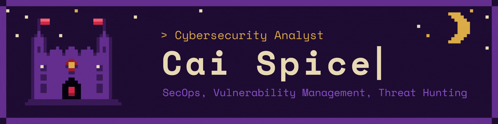
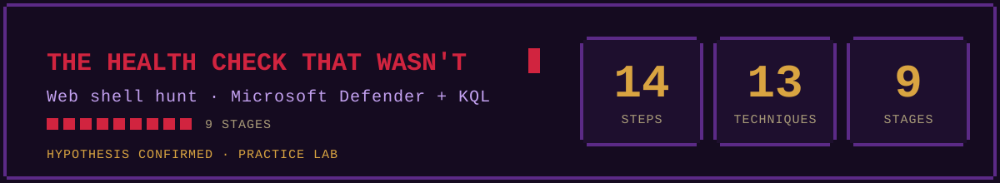

 

✴ **WGU B.S Cybersecurity ✴ Sentinel, KQL, Threat Hunting ✴ CompTIA Pentest+, CySA+, Security+, Network+ certified** ✴ 

## ⚔️ Projects

    

This report is a solo threat hunt that was triggered by one auditd alert. An alert from the Apache web server indicated file writes to the webroot by *www-data* service, an account that should never write files outside of the Wordpress upload directory. Using Microsoft Defender and KQL, I traced the whole intrusion, from Nmap scanning and a PHP session.upload_progress exploit to a web shell named health-check.php. There's commands encoded by ROT13 and Base64, credential theft from wp-config.php, the attacker's failed attempt to turn off monitoring, cronjob persistence, and data exfiltration through the shell's own HTTP responses. The intrusion is mapped to 13 MITRE ATT&CK techniques. The attacker never escalated privileges above the unprivileged www-data account and no evidence pointed to lateral movement. The report ends with containment steps, IOCs, and lessons learned.

[Read the Report](https://github.com/cai-spice/php2shell-threat-hunt) → 

## 🕯️ Currently Learning 

✴   Advanced KQL and detection engineering  
✴   Python for security automation  

## 🐦‍⬛ Send a Raven

✴ 🌐 [caibytes.carrd.co](https://caibytes.carrd.co)  
✴ ✉️ [Email me](mailto:cai.spice06@gmail.com)  
✴ 👩‍💻 [LinkedIn](https://www.linkedin.com/in/cai-spice-/)
<!-- - 🔗 [[OTHER-LINK]](https://[OTHER-LINK]) -->

  

 
 

*Keep it secret, keep it safe.*

